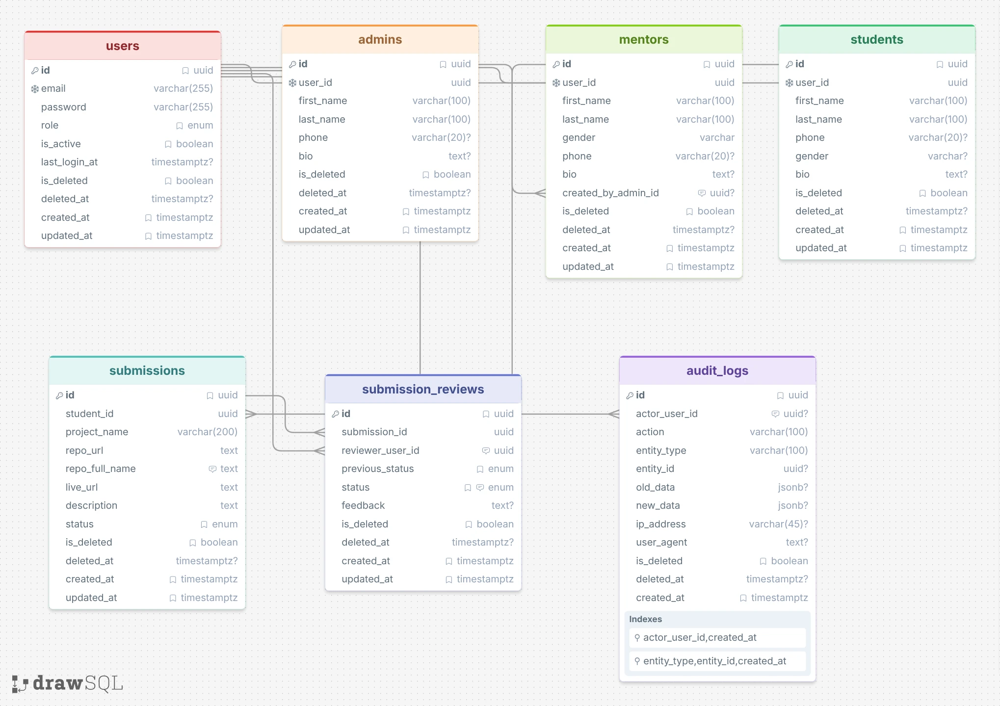

# Project Submission Backend

A REST API for a role-based project submission and review platform. Students can submit and track their projects, while Mentors and Admins can review submissions and manage the relevant records.

## Live Links

- [Production Backend API](https://api-project-submission.iblossomlearn.org/api/v1)
- [Backend Health Check](https://api-project-submission.iblossomlearn.org/health)
- [Frontend Repository](https://github.com/sampod76/project-submission-dashboard)
- [Frontend live site](https://project-submission.iblossomlearn.org/)

The backend domain is confirmed by the Nginx configuration. A frontend live application URL could not be verified from the project configuration or the linked repository.

## Tech Stack

- Node.js, Express.js, TypeScript
- PostgreSQL, Prisma ORM
- JWT authentication and role-based authorization
- Zod validation, bcryptjs, rate limiting
- pnpm

## Key Features

- **Student:** Registration, authentication, profile management, and project submissions.
- **Mentor:** Paginated submission review, approval, rejection or revision requests, statistics, and student management.
- **Admin:** Mentor and user management, submission reviews, dashboard statistics, and audit logs.
- Access and refresh tokens, request validation, filtering, pagination, and soft deletion.

## Getting Started

### Prerequisites

- Node.js `^20.19.0`, `^22.12.0`, or `>=24.0.0`
- pnpm 10.33.0 (declared in `package.json`)
- PostgreSQL

### 1. Clone and install

```bash
git clone https://github.com/sampod76/project-submission-backend.git
cd project-submission-backend
pnpm install
```

### 2. Configure environment

Copy [`.env.example`](.env.example) to `.env` in the project root:

```bash
cp .env.example .env
```

On PowerShell, use `Copy-Item .env.example .env` instead.

| Variable                           | Configuration                                                                                     |
| ---------------------------------- | ------------------------------------------------------------------------------------------------- |
| `DATABASE_URL`                     | Connection URL for your local PostgreSQL database. Create the database before running migrations. |
| `JWT_SECRET`, `JWT_REFRESH_SECRET` | Set separate random secrets; each must contain at least 16 characters.                            |
| `PORT`                             | API port; defaults to `5000`.                                                                     |
| `CORS_ORIGIN`                      | Allowed frontend origin(s), separated by commas; the example uses `http://localhost:3000`.        |
| `TEST_DATABASE_URL`                | Separate PostgreSQL database for integration tests; never reuse the development database.         |

Keep the `SEED_ADMIN_*` and `SEED_MENTOR_*` settings for local demo accounts, or customize them before seeding. Do not commit your real `.env` file.

### 3. Prepare the database

```bash
pnpm prisma:generate
pnpm db:migrate
pnpm seed
```

`pnpm seed` creates the configured Admin and Mentor accounts. In development, it also loads demo users and submissions from `prisma/seed-data.json` unless `SEED_DEMO_DATA=false`. In production, demo data requires explicitly setting `SEED_DEMO_DATA=true`.

### 4. Start the API

```bash
pnpm dev
```

- API base: `http://localhost:5000/api/v1`
- Health check: `http://localhost:5000/health`

For a production build:

```bash
pnpm db:deploy
pnpm build
pnpm start
```

Apply committed migrations to the target database before starting the production server. Do not use `db:migrate` against production data.

## Demo Credentials

These public example accounts come from [`.env.example`](.env.example) and [the seed dataset](prisma/seed-data.json). They are available locally after seeding with the example settings; deployed account credentials have not been verified.

| Role    | Email               | Password      |
| ------- | ------------------- | ------------- |
| Admin   | `admin@gmail.com`   | `Ae11223344?` |
| Mentor  | `mentor@gmail.com`  | `Me11223344?` |
| Student | `student@gmail.com` | `Sa11223344?` |

The Student account requires demo data to be enabled. Use these credentials only for demonstration.

## API Overview

All routes below are relative to `/api/v1`, and protected routes require an `Authorization: Bearer <access_token>` header.

| Module             | Method | Endpoint                   | Purpose / access                                                           |
| ------------------ | ------ | -------------------------- | -------------------------------------------------------------------------- |
| Authentication     | POST   | `/auth/register`           | Register a student (public)                                                |
| Authentication     | POST   | `/auth/login`              | Log in (public)                                                            |
| Authentication     | POST   | `/auth/refresh-token`      | Refresh an access token using a refresh token                              |
| Authentication     | POST   | `/auth/logout`             | Log out (authenticated)                                                    |
| Authentication     | GET    | `/auth/session`            | Read current session (authenticated)                                       |
| Users / Profiles   | GET    | `/users/profile`           | Read own profile (authenticated)                                           |
| Users / Profiles   | PATCH  | `/users/profile`           | Update own profile (authenticated)                                         |
| Users / Profiles   | GET    | `/users`                   | List permitted users (Admin/Mentor)                                        |
| Students           | GET    | `/students`                | List students (Admin/Mentor)                                               |
| Mentors            | GET    | `/mentors`                 | List mentors (Admin)                                                       |
| Mentors            | POST   | `/mentors`                 | Create a mentor (Admin)                                                    |
| Admins             | GET    | `/admins`                  | List admins (Admin)                                                        |
| Submissions        | POST   | `/submissions`             | Submit a project (Student)                                                 |
| Submissions        | GET    | `/submissions/my`          | List own submissions (Student)                                             |
| Submissions        | GET    | `/submissions`             | List submissions (Admin/Mentor)                                            |
| Submissions        | GET    | `/submissions/statistics`  | Statistics; Students see their own counts                                  |
| Submissions        | PATCH  | `/submissions/:id`         | Edit an owned pending submission (Student)                                 |
| Submission Reviews | POST   | `/submissions/:id/reviews` | Approve, reject or request revision on a pending submission (Admin/Mentor) |
| Submission Reviews | GET    | `/submissions/:id/reviews` | View review history (Admin/Mentor)                                         |
| Audit Logs         | GET    | `/audit-logs`              | View permitted audit history (Admin/Mentor)                                |

## Database Diagram

The PostgreSQL database uses separate `auth`, `submissions`, and `logs` schemas.



[SQL schema source](assets/database-diagram.sql)

## Postman Collection

Import [Project Submission Postman Collection](assets/project-submission.postman_collection.json) into Postman to explore and test the backend APIs. Set its `base_url` variable to `http://localhost:5000` or `https://api-project-submission.iblossomlearn.org`, without `/api/v1`; the requests already include that prefix. Configure login credentials and tokens for the role required by each request.

## Frontend Repository

[Project Submission Dashboard](https://github.com/sampod76/project-submission-dashboard)
